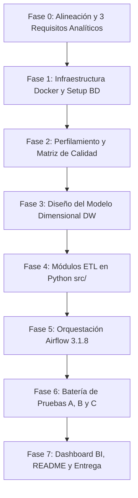

# Análisis Completo y Plan de Ejecución: Workshop-2 (ETL)
**Building a Reliable Batch Data Pipeline**
*Universidad Autónoma de Occidente (UAO) — Facultad de Ingeniería y Ciencias Básicas*  
*Programa Académico: Ingeniería de Datos e Inteligencia Artificial*  
*Curso: ETL (G01)*

---

## 1. Resumen Ejecutivo y Principios de Ingeniería

El objetivo central de este taller es diseñar, implementar, validar, orquestar, monitorear y documentar un **pipeline de datos por lotes (batch) confiable** que integre dos fuentes heterogéneas (**Spotify** y **Grammy Awards**), garantizando compuertas automatizadas de calidad de datos y culminando en un **Data Warehouse dimensional (modelo en estrella)** consultado por un dashboard analítico.

### Principios Rectores Evaluados
1. **"A Data Engineer does not build scripts. A Data Engineer designs systems."**  
   No se evalúa una colección de scripts sueltos, sino un sistema integrado, reproducible y con separación de responsabilidades.
2. **"Reliable data pipelines do not assume that data is correct. They verify it."**  
   Los datos no se dan por buenos; se inspeccionan rigurosamente mediante compuertas automáticas de validación.
3. **"Reliable does not mean that nothing fails. Reliable means that failures are anticipated, controlled, and observable."**  
   Un sistema confiable anticipa fallos, detiene el procesamiento antes de contaminar capas posteriores y deja evidencia clara y accionable en logs.
4. **"Validation detects violations; transformation applies known engineering rules."**  
   Validación y transformación son actividades separadas. **Está prohibido modificar datos únicamente para hacer pasar una validación.**

---

## 2. ¿Qué se debe hacer? (Alcance y Requerimientos del Sistema)

El pipeline debe cumplir de extremo a extremo con el siguiente flujo de valor:

```
[Fuente Spotify (CSV)] ───► [Extract Spotify] ───► [Validate Raw (GX)] ──┐
                                                                         ├──► [Transform & Integrate] ──► [Validate Prepared (GX)] ──► [Load DW] ──► [Dashboard & KPIs]
[Fuente Grammys (DB)]  ───► [Extract Grammys] ───► [Validate Raw (GX)] ──┘
```

### Componentes Funcionales Obligatorios:
1. **Definición Analítica Previa:** Formular al menos **3 requisitos analíticos** que requieran estrictamente la combinación de datos de Spotify y Grammy Awards.
2. **Extracción Heterogénea:**
   * **Spotify:** Extracción directa desde el archivo CSV provisto (`spotify_dataset.csv`, ~114,000 registros).
   * **Grammy Awards:** Carga previa (*seeding*) del archivo CSV provisto (`the_grammy_awards.csv`, ~4,810 registros) en una **base de datos relacional (PostgreSQL o MySQL)**. El pipeline en operación **debe extraer los Grammys desde la base de datos relacional mediante SQL**, nunca del CSV directo.
3. **Perfilamiento de Datos (*Data Profiling*):** Creación de un notebook reproducible (`notebooks/data_profiling.ipynb`) que analice estructura, completitud, unicidad, tipos, dominios categóricos, distribuciones numéricas, aspectos temporales y consistencia cruzada.
4. **Validación Automatizada con Great Expectations (GX):**
   * Definir al menos **6 reglas de calidad significativas** con severidades asignadas (`Critical`, `Warning`, `Informational`).
   * **Compuerta Raw:** Validar las dos fuentes crudas de forma independiente.
   * **Compuerta Prepared:** Validar el dataset limpio e integrado antes de tocar el Data Warehouse.
5. **Transformación e Integración de Datos:**
   * Limpieza, estandarización y armonización justificadas mediante evidencia.
   * Contrato de integración formal: claves de cruce (*matching keys*), cardinalidad esperada, tratamiento de no coincidentes (*unmatched*) y registros duplicados.
6. **Data Warehouse Dimensional:**
   * Implementación física de un **Modelo en Estrella (Star Schema)** en PostgreSQL o MySQL.
   * Tabla(s) de hechos con grano definido y tablas de dimensiones con claves subrogadas (*surrogate keys*).
   * Carga idempotente y estrategia de **reejecución segura (*safe rerun*)**.
7. **Orquestación en Apache Airflow 3.1.8:**
   * DAG modular utilizando la **TaskFlow API** moderna (`from airflow.sdk import dag, task`).
   * Manejo estricto de dependencias, políticas de reintentos selectivos y aislamiento de fallos.
8. **Analítica y Visualizaciones:**
   * Construcción de al menos **3 KPIs** y **3 visualizaciones interactivas** en Power BI, Looker Studio o Tableau conectadas **directamente al Data Warehouse** (no al CSV).
9. **Batería de Pruebas de Confiabilidad y Evidencias:**
   * **Test A:** Ejecución exitosa de extremo a extremo.
   * **Test B:** Falla crítica controlada (violación intencional de regla crítica en raw, verificando la parada automática del DAG y la preservación de logs diagnósticos).
   * **Test C:** Reejecución segura (comprobando que ejecutar el pipeline dos veces con el mismo lote no duplica datos en el DW).

---

## 3. ¿Cómo se debe hacer? (Arquitectura Técnica y Metodología)

### 3.1 Cadena de Razonamiento End-to-End
Cada decisión de diseño debe estar trazada bajo el siguiente esquema:
$$\text{Requisito Analítico} \rightarrow \text{Datos Requeridos} \rightarrow \text{Perfilamiento} \rightarrow \text{Riesgo de Calidad} \rightarrow \text{Dimensión DQ} \rightarrow \text{Regla DQ} \rightarrow \text{Métrica/Umbral} \rightarrow \text{Expectation GX} \rightarrow \text{Acción del Pipeline}$$

### 3.2 Clasificación de Severidades en Reglas de Calidad
* **Critical:** La violación compromete la integridad del modelo o del análisis. **Detiene el flujo downstream inmediatamente** (el pipeline falla de forma controlada).
* **Warning:** La anomalía requiere visibilidad pero permite continuar el procesamiento bajo una política documentada.
* **Informational:** Métrica de tendencia o monitoreo de contexto; no bloquea.

### 3.3 Contrato de Integración de Fuentes
* Las fuentes no comparten claves primarias idénticas de forma nativa.
* Se debe documentar:
  * Normalización previa (ej. minúsculas, eliminación de signos de puntuación, limpieza de artistas colaboradores separados por `;` en Spotify vs nombres en Grammys).
  * Tipo de emparejamiento (coincidencia exacta, coincidencia normalizada o estrategia de enlace).
  * Cardinalidad esperada (uno a uno, uno a muchos, etc.).
  * Medición y tratamiento de registros huérfanos/no emparejados.

### 3.4 Modelo Dimensional (Data Warehouse)
* **Tabla de Hechos (Fact):** Grano explícito (ej. *una fila por interpretación musical / track evaluado en contexto de premiación y consumo*). Métricas aditivas/semiaditivas: popularidad, métricas de audio (danceability, energy, loudness), conteo de premios ganados, conteo de nominaciones.
* **Dimensiones (Dims):**
  * `dim_artist`: Datos del artista, nombre normalizado.
  * `dim_track`: Título de la pista, álbum, características de audio estáticas, duración, contenido explícito.
  * `dim_grammy_category`: Categorías de los premios Grammy.
  * `dim_time`: Años, décadas, marcas de tiempo.
  * `dim_genre`: Géneros musicales de Spotify.

---

## 4. Herramientas y Stack Tecnológico

| Dominio | Herramienta Exigida / Permitida | Justificación y Restricciones |
| :--- | :--- | :--- |
| **Orquestación** | **Apache Airflow 3.1.8** en Docker / Docker Compose | Debe reportar versión exacta 3.1.8. |
| **Sintaxis DAG** | **Python + Airflow TaskFlow API** | Importación obligatoria: `from airflow.sdk import dag, task`. |
| **Validación de Calidad** | **Great Expectations (GX)** | Checkpoints y Expectation Suites automáticos en compuertas raw y prepared. |
| **Base de Datos Operacional y DW** | **PostgreSQL** o **MySQL** | ❌ **SQLite está terminantemente PROHIBIDO**. Se recomienda PostgreSQL por su robustez y soporte analítico. |
| **Lenguaje de Programación** | **Python 3.11+** | Modularizado en scripts independientes bajo el paquete `src/`. |
| **Visualización / BI** | **Power BI, Tableau o Looker Studio** | Debe conectarse mediante JDBC/ODBC al DW en PostgreSQL/MySQL. |
| **Control de Versiones** | **Git y GitHub** | Repositorio estructurado y reproducible. |
| **Infraestructura** | **Docker & Docker Compose** | Contenerización completa de servicios. |

---

## 5. Restricciones Críticas y Políticas No Negociables ("Gotchas")

1. ⚠️ **SQLite queda totalmente descartado:** Usar SQLite como fuente operativa o Data Warehouse anula el componente de base de datos. Se debe usar PostgreSQL o MySQL.
2. ⚠️ **Prohibido extraer Grammys del CSV en el DAG:** El CSV de Grammys solo se utiliza en la fase de preparación de la fuente (*source setup*). El DAG en Airflow debe ejecutar queries SQL contra la base de datos relacional para extraer los registros de Grammys.
3. ⚠️ **Prohibido transportar datasets masivos por XCom:** En la TaskFlow API de Airflow, no se deben retornar DataFrames completos entre tareas (esto colapsa la base de metadatos de Airflow). Se deben guardar archivos intermedios (ej. Parquet/CSV en volumen compartido) y pasar únicamente **rutas de archivo** o **metadatos de resumen** (conteos, IDs de lote).
4. ⚠️ **Prohibida la política de reintentos indiscriminada (`retries=3` generalizado):**
   * Fallos transitorios (conexión a DB, red): Reintentos con retardo y backoff justificados.
   * Fallos determinísticos (violación de regla crítica GX, esquema corrupto): `retries=0`. Un error de datos no se soluciona reintentando; debe fallar de inmediato.
5. ⚠️ **No limpiar datos para complacer la validación Raw:** La compuerta raw debe evaluar los datos tal como provienen de la fuente. La limpieza ocurre formalmente en `transform_and_integrate`.
6. ⚠️ **Higiene estricta de seguridad:** Ningún secreto, clave de base de datos o API key debe subirse al repositorio. Se requiere `.env.example` y un archivo `.gitignore` exhaustivo.
7. ⚠️ **Dashboard conectado exclusivamente al DW:** Conectar el dashboard al CSV de Spotify o Grammys invalida el entregable de analítica. Debe consultar el esquema dimensional en PostgreSQL/MySQL.
8. ⚠️ **Evidencias interpretadas:** Toda captura en el informe de evidencias debe estar recortada, ser legible y contener una explicación técnica de qué demuestra.

---

## 6. Estructura Sugerida del Repositorio

```text
WorkShop2ETL/
├── dags/
│   └── reliable_music_pipeline.py    # Orquestación con TaskFlow API (airflow.sdk)
├── src/
│   ├── __init__.py
│   ├── extract.py                    # Extracción: Spotify (CSV) y Grammys (SQL)
│   ├── transform.py                  # Limpieza, armonización y contrato de integración
│   ├── validation.py                 # Suites y checkpoints de Great Expectations
│   └── load.py                       # Carga dimensional e idempotente en el DW
├── gx/                               # Contexto y suites de Great Expectations
├── notebooks/
│   └── data_profiling.ipynb          # Notebook reproducible de análisis exploratorio
├── sql/
│   ├── source_setup.sql              # Creación y carga de la BD relacional de Grammys
│   └── dw_schema.sql                 # DDL del modelo estrella (Dimensiones y Hechos)
├── docs/
│   ├── architecture.md               # Diagramas conceptuales y de arquitectura
│   ├── quality_rules.md              # Matriz de riesgos, reglas y umbrales
│   └── evidence/                     # Evidencias organizadas con interpretación
│       ├── test_a_success/           # Capturas de ejecución exitosa
│       ├── test_b_controlled_failure/# Capturas de fallo crítico controlado y logs
│       └── test_c_safe_rerun/        # Comparación de métricas antes y después del rerun
├── requirements.txt                  # Dependencias de Python
├── docker-compose.yaml               # Servicios: Airflow 3.1.8 + PostgreSQL
├── .env.example                      # Variables de entorno sin credenciales reales
├── .gitignore                        # Exclusión de archivos sensibles y temporales
└── README.md                         # Documentación maestra con las 16 secciones
```

---

## 7. Estructura Obligatoria del README.md (Checklist de 16 Puntos)

El `README.md` es el núcleo de la evaluación y debe documentar explícitamente:
1. Problema y objetivo analítico.
2. Definición de los 3 requisitos analíticos.
3. Descripción y caracterización de las fuentes de datos.
4. Diagrama y explicación de la arquitectura del pipeline.
5. Hallazgos del perfilamiento de datos.
6. Matriz de riesgos de calidad y reglas definidas.
7. Diseño de validación en Great Expectations (suites raw y prepared).
8. Estrategia de transformación y contrato de integración (matching rules, cardinalidad).
9. Modelo dimensional (grano de hechos, dimensiones, claves subrogadas).
10. Diseño del DAG en Airflow (ramas, TaskFlow API, interfaces).
11. Política de fallos y justificación de reintentos selectivos.
12. Evidencia de ejecución exitosa (Test A).
13. Evidencia de fallo crítico controlado (Test B).
14. Estrategia y evidencia de reejecución segura / repetibilidad (Test C).
15. Dashboard y analítica conectada al DW (3 KPIs y 3 visualizaciones).
16. Instrucciones de instalación, despliegue y supuestos/limitaciones del sistema.

---

## 8. Criterios de Evaluación y Calificación

| Criterio | Descripción | Puntos |
| :--- | :--- | :---: |
| **1. Requisitos Analíticos y Arquitectura** | Requisitos, datos requeridos, arquitectura y trazabilidad end-to-end. | 0.40 |
| **2. Perfilamiento y Análisis de Riesgos** | Perfilamiento basado en evidencia, riesgos, dimensiones, reglas y umbrales. | 0.60 |
| **3. Transformación ETL e Integración** | Extracción correcta, limpieza justificada, integración y reconciliación. | 0.60 |
| **4. Validación Automatizada (GX)** | Compuertas raw y prepared, Expectations significativas, políticas operativas. | 0.80 |
| **5. Orquestación y Confiabilidad (Airflow)**| DAG, dependencias, reintentos selectivos, logs, falla controlada y safe rerun. | 0.90 |
| **6. Data Warehouse Dimensional y Analítica** | Modelo en estrella, consultas de KPIs y dashboard conectado al DW. | 0.40 |
| **7. Repositorio y Documentación** | Estructura, reproducibilidad, README completo, evidencias y seguridad. | 0.30 |
| **Subtotal Solución / Repositorio (80%)** | | **4.00** |
| **Defensa y Presentación Técnica (20%)** | Claridad técnica, demostración en vivo de tests y respuestas a preguntas. | **1.00** |
| **TOTAL** | | **5.00** |

---

## 9. Plan de Acción y Roadmap de Desarrollo (Paso a Paso)



### Fase 0: Definición de Requisitos Analíticos y Trazabilidad
* **Objetivo:** Establecer la base del negocio que justifica cada dato extraído y transformado.
* **Acciones:**
  1. Definir los 3 requisitos analíticos de cruce Spotify-Grammys (ej. *RQ1: Correlación entre atributos sonoros de Spotify y tasa de victoria en Grammys; RQ2: Impacto del Grammy en popularidad por género; RQ3: Evolución de colaboraciones en canciones ganadoras vs promedio de catálogo*).
  2. Construir la tabla formal de requisitos analíticos (ID, Requisito, Datos Requeridos, Fuente, KPI Esperado, Grano).

### Fase 1: Infraestructura Docker y Preparación de Fuentes
* **Objetivo:** Disponer de un entorno contenerizado reproducible con Airflow 3.1.8 y PostgreSQL.
* **Acciones:**
  1. Diseñar `docker-compose.yaml` levantando PostgreSQL (configurando dos bases de datos o esquemas: `source_db` para la fuente operativa de Grammys y `dw_db` para el Data Warehouse) y Apache Airflow 3.1.8.
  2. Crear `sql/source_setup.sql` y el script de ingestión inicial para cargar `the_grammy_awards.csv` en `source_db.grammy_awards`.
  3. Validar la reconciliación de filas del CSV de Grammys contra la tabla cargada.
  4. Configurar `.env.example` y `.gitignore`.

### Fase 2: Perfilamiento de Datos y Matriz de Riesgos de Calidad
* **Objetivo:** Extraer evidencia empírica para justificar las reglas de limpieza y validación.
* **Acciones:**
  1. Implementar el notebook `notebooks/data_profiling.ipynb`.
  2. Analizar volumen, nulos, unicidad de IDs de Spotify, duplicados, distribución de popularidad/duración, y analizar cómo vienen los nombres de artistas y canciones en ambas fuentes.
  3. Redactar `docs/quality_rules.md` con al menos 6 reglas mapeadas a severidades (`Critical`, `Warning`, `Informational`) y umbrales basados en métricas observadas.

### Fase 3: Diseño del Modelo Dimensional (Data Warehouse)
* **Objetivo:** Definir la estructura analítica de destino en esquema estrella.
* **Acciones:**
  1. Declarar el grano de la tabla de hechos.
  2. Modelar dimensiones (`dim_artist`, `dim_track`, `dim_grammy_category`, `dim_time`, `dim_genre`) y hechos (`fact_music_performance` / `fact_grammy_acclaim`).
  3. Crear el script DDL ejecutable `sql/dw_schema.sql` con claves primarias, foráneas, índices y claves subrogadas.

### Fase 4: Desarrollo de los Módulos ETL en Python (`src/`)
* **Objetivo:** Codificar la lógica desacoplada y reutilizable.
* **Acciones:**
  1. `src/extract.py`: Funciones para extraer Spotify desde CSV y Grammys desde PostgreSQL.
  2. `src/validation.py`: Implementación de Great Expectations para evaluar las suites de validación raw y prepared.
  3. `src/transform.py`: Limpieza de cadenas, estandarización de artistas, ejecución del contrato de integración (matching rules) y cálculo de atributos derivados.
  4. `src/load.py`: Carga dimensional en PostgreSQL con lógica idempotente (ej. `ON CONFLICT DO UPDATE` o reemplazo controlado por lote) para asegurar repetibilidad.

### Fase 5: Orquestación con Apache Airflow 3.1.8 (`dags/`)
* **Objetivo:** Exponer la arquitectura completa en un DAG observable y confiable.
* **Acciones:**
  1. Implementar `dags/reliable_music_pipeline.py` con `from airflow.sdk import dag, task`.
  2. Configurar ramas independientes:
     * `extract_spotify` ➔ `validate_spotify_raw`
     * `extract_grammys` ➔ `validate_grammys_raw`
  3. Establecer convergencia en `transform_and_integrate` ➔ `validate_prepared` ➔ `load_dw`.
  4. Pasar únicamente referencias/rutas de archivos y metadatos por XCom.
  5. Configurar políticas de reintentos selectivos (retries solo en fallos transitorios operacionales; 0 retries en fallos determinísticos de datos).

### Fase 6: Pruebas Obligatorias de Confiabilidad y Evidencias
* **Objetivo:** Demostrar que el sistema anticipa, controla y aisla las fallas.
* **Acciones:**
  1. **Test A (Éxito):** Ejecución limpia completa; capturar vistas Grid/Graph en Airflow, logs de éxito y conteos en el DW.
  2. **Test B (Falla Crítica Controlada):** Modificar un lote o inyectar un dato inválido que viole una regla crítica raw; documentar la parada automática del DAG, el log de GX y que las tareas downstream no se ejecutaron.
  3. **Test C (Reejecución Segura):** Reejecutar el pipeline con el mismo lote y comparar mediante consultas SQL que el DW mantiene exactamente los mismos conteos y medidas sin duplicados.
  4. Guardar todas las capturas con su correspondiente análisis técnico en `docs/evidence/`.

### Fase 7: Dashboard de BI, README Completo y Auditoría Final
* **Objetivo:** Conectar la analítica y cerrar la entrega con estándares profesionales.
* **Acciones:**
  1. Conectar Power BI / Looker Studio al DW en PostgreSQL y construir los 3 KPIs y 3 visualizaciones requeridas.
  2. Redactar el `README.md` cubriendo con precisión quirúrgica las 16 secciones requeridas.
  3. Ejecutar escaneo de seguridad de secretos antes del commit final.
  4. Preparar la estructura de soporte para la sustentación y defensa oral del 20%.
