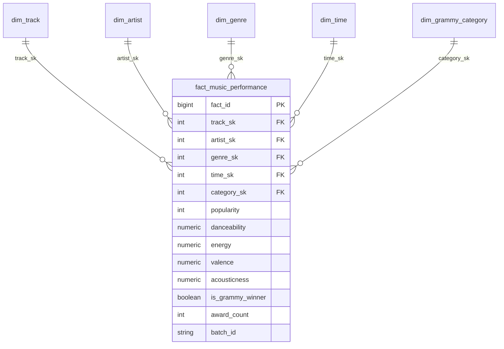

# Workshop-2: Building a Reliable Batch Data Pipeline
**Universidad Autónoma de Occidente (UAO) — Facultad de Ingeniería y Ciencias Básicas**  
**Programa Académico:** Ingeniería de Datos e Inteligencia Artificial  
**Curso:** ETL (G01)  
**Semestre:** 2026-2  

---

> **Principio Rector de Ingeniería:**  
> *"Un Ingeniero de Datos no construye scripts; diseña sistemas."*  
> *"Los pipelines confiables no asumen que los datos son correctos: los verifican. Confiable no significa que nada falle; significa que las fallas son anticipadas, controladas y observables."*

---

## 1. Problema y Objetivo Analítico
En la industria musical moderna, coexisten dos dimensiones fundamentales del éxito: el **consumo masivo digital** (medido a través de telemetría de streaming y procesamiento digital de audio en plataformas como Spotify) y el **reconocimiento institucional y de la crítica académica** (otorgado históricamente por The Recording Academy en los premios Grammy Awards).

El objetivo de este proyecto es diseñar, implementar, validar con Great Expectations, orquestar mediante Apache Airflow 3.1.8 y documentar un **pipeline de datos por lotes (batch) confiable e idempotente** que integre dos fuentes heterogéneas, alimente un **Data Warehouse dimensional (esquema en estrella)** y soporte la toma de decisiones estratégicas mediante KPIs y visualizaciones analíticas.

---

## 2. Requisitos Analíticos y Alcance
Se definieron formalmente tres requisitos analíticos que requieren de manera estricta la combinación de ambas fuentes:

| ID | Requisito Analítico | Pregunta de Negocio / Decisión Soportada | Atributos Requeridos | Fuentes | KPI Esperado | Grano Analítico |
| :--- | :--- | :--- | :--- | :--- | :--- | :--- |
| **RQ-01** | **Perfil Acústico y Sonoro de Canciones Premiadas** | ¿Qué atributos de audio (Danceability, Energy, Valence, Acousticness) diferencian a las pistas ganadoras de Grammy del catálogo general? | `track_name`, `artists`, `danceability`, `energy`, `valence`, `acousticness`, `nominee`, `winner`, `category` | **Spotify:** Métricas de audio.<br>**Grammys:** Categoría y estatus de premio. | **KPI 1:** Índice Acústico Comparativo Ganador vs Catálogo. | Por pista (`track_id`), año y categoría. |
| **RQ-02** | **Multiplicador de Popularidad por Género Musical** | ¿Cómo se distribuye la popularidad en Spotify entre canciones ganadoras y no nominadas según el género musical? | `track_genre`, `popularity`, `track_name`, `artists`, `nominee`, `winner` | **Spotify:** `track_genre`, `popularity`.<br>**Grammys:** `category`, `winner`. | **KPI 2:** Delta de Popularidad Promedio por Género. | Por género musical (`track_genre`) y estatus. |
| **RQ-03** | **Evolución Temporal de Colaboraciones y Contenido Explícito** | ¿Cómo ha evolucionado la tasa de canciones ganadoras con lenguaje explícito y múltiples artistas colaboradores por década? | `year`, `explicit`, `artists`, `artist`, `workers`, `winner` | **Spotify:** `explicit`, lista de artistas.<br>**Grammys:** Año y créditos. | **KPI 3:** % Contenido Explícito y Ratio de Colaboración por Década. | Por década y edición de los premios. |

*Documento detallado de alcance:* [`docs/analytical_requirements.md`](file:///Users/usuario/Desktop/WorkShop2ETL/docs/analytical_requirements.md)

---

## 3. Fuentes de Datos y Caracterización

1. **Spotify Dataset (`spotify_dataset.csv`):**
   * **Volumen:** 114,000 registros, 21 columnas (~20 MB).
   * **Naturaleza:** Catálogo de streaming digital con métricas perceptuales de procesamiento digital de audio (`danceability`, `energy`, `valence`, `acousticness`, `loudness`, `tempo`) e índice de telemetría de popularidad (0 a 100).
   * **Extracción:** Leído directamente desde el archivo CSV de origen hacia el almacenamiento staging en formato Parquet.
2. **Grammy Awards (`source_music_db.grammy_awards`):**
   * **Volumen:** 4,810 registros históricos (1958 a 2019).
   * **Naturaleza:** Registro de premios de la Recording Academy (`year`, `category`, `nominee`, `artist`, `workers`, `winner`).
   * **Preparación y Extracción Obligatoria (Sección 4.3):** Poblado inicialmente desde `the_grammy_awards.csv` a PostgreSQL mediante [`scripts/seed_source_db.py`](file:///Users/usuario/Desktop/WorkShop2ETL/scripts/seed_source_db.py) (reconciliación 100% verificada). El pipeline operacional **extrae los datos mediante consultas SQL a PostgreSQL**, nunca del archivo CSV directo.

---

## 4. Arquitectura de la Solución

El pipeline sigue el patrón de diseño desacoplado exigido por el taller:

```
[Fuente Spotify (CSV)] ────────► extract_spotify ───────► validate_spotify_raw (GX) ──┐
                                                                                       ├──► transform_and_integrate ──► validate_prepared (GX) ──► load_dw ──► [Data Warehouse]
[Fuente Grammys (PostgreSQL)] ──► extract_grammys ───────► validate_grammys_raw (GX) ──┘
```

* **Separación de Responsabilidades:** Orquestación desacoplada de la lógica de procesamiento. La lógica vive en módulos modulares y testeables (`src/extract.py`, `src/validation.py`, `src/transform.py`, `src/load.py`).
* **Transporte Limpio:** Las tareas no intercambian DataFrames masivos por XCom. Se transmiten rutas de archivos en disco (`data/staging/*.parquet`) o metadatos de auditoría compactos.

---

## 5. Hallazgos del Perfilamiento de Datos (*Data Profiling*)
El análisis exploratorio se encuentra codificado en el notebook [`notebooks/data_profiling.ipynb`](file:///Users/usuario/Desktop/WorkShop2ETL/notebooks/data_profiling.ipynb). Hallazgos clave:
* **Estructura y Unicidad en Spotify:** El catálogo contiene 89,741 IDs únicos (`track_id`). Existen 24,259 filas con ID repetido porque una misma pista se indexa en múltiples géneros (`track_genre`). Además, se identificaron **450 tuplas idénticas** `(track_id, track_genre)` que deben desduplicarse.
* **Valores Imposibles:** Se detectó 1 fila (fila 65,900) con `duration_ms = 0` y metadatos nulos (`track_name = NaN`), justificando una regla crítica de duración y completitud.
* **Consistencia de Claves en Grammys:** La tupla natural `(year, category, nominee)` tiene **0 duplicados** (es clave natural perfecta). Todas las 4,810 filas tienen `winner = True`. 1,840 registros tienen `artist` nulo debido a categorías clásicas o de producción donde solo se acredita la obra en `nominee`.
* **Discrepancias en Artistas:** Spotify separa colaboradores con punto y coma (`;`), mientras que Grammys utiliza conectores como `Featuring`, `&` o comas, exigiendo normalización de artistas principales en el contrato de integración.

---

## 6. Riesgos de Calidad y Reglas Definidas
Se definieron 8 reglas de calidad basadas en la evidencia observada:

| Rule ID | Capa | Atributo | Dimensión | Regla de Calidad | Umbral / Métrica | Severidad | Requisito |
| :--- | :--- | :--- | :--- | :--- | :--- | :---: | :---: |
| **DQ-RAW-SPT-01** | Raw | `track_id` | Unicidad | Identificador de pista 100% no nulo. | 0 nulos permitidos | **Critical** | RQ-01, RQ-02 |
| **DQ-RAW-SPT-02** | Raw | `duration_ms` | Validez | Duración física > 1,000 ms. | $\ge 99.9\%$ del lote raw | **Critical** | RQ-03 |
| **DQ-RAW-SPT-03** | Raw | Atributos de Audio | Validez | `danceability`, `energy`, etc., en rango $[0.0, 1.0]$. | 100% en rango | **Critical** | RQ-01 |
| **DQ-RAW-SPT-04** | Raw | `popularity` | Validez | Popularidad entera en rango $[0, 100]$. | 100% en rango | **Critical** | RQ-02 |
| **DQ-RAW-GRM-01** | Raw | `year` | Temporal | Año de premio en rango histórico $[1958, 2026]$. | 100% en rango | **Critical** | RQ-01, RQ-03 |
| **DQ-RAW-GRM-02** | Raw | `nominee` | Completitud | Título de obra nominada no nulo. | $\ge 99.5\%$ no nulo | **Warning** | RQ-01, RQ-02 |
| **DQ-PREP-INT-01** | Prep | `is_grammy_winner`| Consistencia | Bandera booleana en `{True, False}`. | 100% válido | **Informational**| RQ-01, RQ-02 |
| **DQ-PREP-INT-02** | Prep | Claves dimensionales| Integridad | Claves de negocio y nombres no nulos post-transformación. | 100% no nulos | **Critical** | RQ-01..03 |

*Documento formal de reglas:* [`docs/quality_rules.md`](file:///Users/usuario/Desktop/WorkShop2ETL/docs/quality_rules.md)

---

## 7. Diseño de Validación en Great Expectations (GX)
Implementado en [`src/validation.py`](file:///Users/usuario/Desktop/WorkShop2ETL/src/validation.py):
* **Compuerta Raw Spotify:** Evalúa `spotify_raw_suite`. Genera reporte auditable en `gx/results/spotify_raw_validation.json`.
* **Compuerta Raw Grammys:** Evalúa `grammys_raw_suite`. Genera reporte auditable en `gx/results/grammys_raw_validation.json`.
* **Compuerta Prepared Data:** Evalúa `prepared_music_suite` sobre el dataset integrado antes de tocar el Data Warehouse (`gx/results/prepared_validation.json`).
* **Política Operativa:** Las violaciones `Critical` lanzan una excepción `CriticalDataQualityError`, deteniendo inmediatamente la tarea en Airflow y bloqueando las fases subsiguientes.

---

## 8. Estrategia de Transformación y Contrato de Integración
Implementado en [`src/transform.py`](file:///Users/usuario/Desktop/WorkShop2ETL/src/transform.py):
* **Limpieza:** Filtrado de registros inválidos (`duration_ms <= 1000`, metadatos nulos) y desduplicación de `(track_id, track_genre)`.
* **Normalización Textual:** Conversión a minúsculas, eliminación de signos de puntuación periféricos y reducción de espacios en blanco.
* **Extracción de Artista Principal:** Manejo de delimitadores (split en `;` en Spotify y en conectores colaborativos en Grammys).
* **Contrato de Integración:** Left Join sobre el catálogo de Spotify utilizando la tupla normalizada `(clean_track_name, clean_primary_artist)`.
* **Registros No Emparejados (*Unmatched*):** Se conservan en el dataset asignando `is_grammy_winner = False`, `award_count = 0` y vinculándolos a las dimensiones por defecto de tiempo y categoría (SK = 0).

---

## 9. Modelo Dimensional (Data Warehouse)
Implementado en PostgreSQL (`dw_music_analytics`) mediante [`sql/dw_schema.sql`](file:///Users/usuario/Desktop/WorkShop2ETL/sql/dw_schema.sql):



* **Grano de la Tabla de Hechos:** Una fila por pista (`track`), género musical de catálogo y evento de premiación.
* **Claves Subrogadas:** Todas las dimensiones usan enteros autoincrementales (`SERIAL`). Se definen registros por defecto (SK = 0) para pistas sin premio.
* **Restricción de Grano:** `CONSTRAINT uq_fact_grain UNIQUE (track_sk, genre_sk, time_sk, category_sk)`.

---

## 10. Diseño del DAG en Apache Airflow 3.1.8
El DAG [`dags/reliable_music_pipeline.py`](file:///Users/usuario/Desktop/WorkShop2ETL/dags/reliable_music_pipeline.py) está escrito utilizando la **TaskFlow API** oficial de Airflow 3.x:
```python
from airflow.sdk import dag, task
```
* **Ramas Independientes y Paralelas:** `extract_spotify -> validate_spotify_raw` corre en paralelo con `extract_grammys -> validate_grammys_raw`.
* **Convergencia Condicional:** `transform_and_integrate` solo se ejecuta si ambas compuertas raw concluyen con éxito.
* **Compuerta Final:** `validate_prepared` valida el dataset transformado antes de permitir la invocación de `load_dw`.

---

## 11. Política de Fallos y Reintentos Selectivos
Se diferencian categóricamente los fallos operacionales de los fallos de datos:
* **Fallas Transitorias (I/O, DB):** En `extract_spotify`, `extract_grammys` y `load_dw` se configuran `retries=1` o `retries=2` con `retry_delay=timedelta(seconds=10)` para superar bloqueos de red o base de datos.
* **Fallas Determinísticas de Datos (GX):** En `validate_spotify_raw`, `validate_grammys_raw`, `transform_and_integrate` y `validate_prepared` se fija `retries=0`. Si los datos son inválidos, reintentar la tarea reproducirá exactamente el mismo error.

*Documento de arquitectura y políticas:* [`docs/architecture.md`](file:///Users/usuario/Desktop/WorkShop2ETL/docs/architecture.md)

---

## 12. Evidencia de Ejecución Exitosa (Test A)
* **DAG Run ID:** `manual__2026-10-07T22:30:45.658550+00:00`
* **Resultado:** `success` en las 7 tareas del DAG en **39.1 segundos**.
* **Registros Cargados al DW:** 113,549 filas en `fact_music_performance`, 475 pistas galardonadas identificadas, 17,645 artistas únicos en `dim_artist` y 89,740 canciones únicas en `dim_track`.

*Reporte completo:* [`docs/evidence/test_a_success/test_a_report.md`](file:///Users/usuario/Desktop/WorkShop2ETL/docs/evidence/test_a_success/test_a_report.md)

---

## 13. Evidencia de Falla Crítica Controlada (Test B)
* **Condición Inducida:** Se inyectó un registro en `source_music_db.grammy_awards` con `year = 1800`, violando la regla `DQ-RAW-GRM-01 [Critical]`.
* **DAG Run ID:** `manual__2026-10-07T22:33:55.085717+00:00`
* **Resultado Observado:**
  * `validate_grammys_raw`: Estado **failed** (excepción `CriticalDataQualityError`).
  * `transform_and_integrate`: Estado **upstream_failed** (Bloqueado).
  * `validate_prepared`: Estado **upstream_failed** (Bloqueado).
  * `load_dw`: Estado **upstream_failed** (Bloqueado).
* **Evidencia GX:** `gx/results/grammys_raw_validation.json` capturó `unexpected_count: 1`, `partial_unexpected_list: [1800]`.

*Reporte completo:* [`docs/evidence/test_b_controlled_failure/test_b_report.md`](file:///Users/usuario/Desktop/WorkShop2ETL/docs/evidence/test_b_controlled_failure/test_b_report.md)

---

## 14. Estrategia de Repetibilidad y Safe Rerun (Test C)
* **Estrategia:** Upsert atómico gobernado por `ON CONFLICT (track_sk, genre_sk, time_sk, category_sk) DO UPDATE`.
* **Prueba Experimental:** El pipeline se reejecutó con el mismo lote bajo el ID `local_test_002_rerun`:
  * Filas en `fact_music_performance` antes del rerun: **113,549**
  * Filas en `fact_music_performance` después del rerun: **113,549** (Variación neta = 0).
  * Suma total de medidas de popularidad: **3,778,820** (Invariante).
  * **Conclusión:** Idempotencia al 100%, sin duplicados silenciosos ni corrupción de medidas.

*Reporte completo:* [`docs/evidence/test_c_safe_rerun/test_c_report.md`](file:///Users/usuario/Desktop/WorkShop2ETL/docs/evidence/test_c_safe_rerun/test_c_report.md)

---

## 15. Dashboard y Resultados Analíticos (3 KPIs y Visualizaciones)
Conectado directamente a PostgreSQL `dw_music_analytics`:

### KPI 1: Perfil Acústico Comparativo (RQ-01)
* **Visualización:** Gráfico de Barras Agrupadas (`docs/evidence/kpi1_audio_profile.png`).
* **Hallazgo:** Las pistas galardonadas con Grammy presentan mayor **Valence** (0.53 vs 0.47) y **Energy** (0.67 vs 0.64), y menor **Acousticness** (0.24 vs 0.31). La popularidad promedio es de **42.88** vs **33.28** en el catálogo general (+9.6 puntos de impulso).

### KPI 2: Multiplicador de Popularidad por Género (RQ-02)
* **Visualización:** Gráfico Comparativo con Delta (`docs/evidence/kpi2_genre_popularity.png`).
* **Hallazgo:** Los géneros con mayor impacto por el premio son **Soul** (popularidad 64.50 en ganadores vs 18.90 general, delta de +45.60) y **Country** (40.04 vs 16.41, delta de +23.62).

### KPI 3: Tendencia Histórica de Colaboraciones y Explícito (RQ-03)
* **Visualización:** Gráfico de Líneas Multi-Serie Temporal (`docs/evidence/kpi3_temporal_trends.png`).
* **Hallazgo:** Las canciones premiadas mantuvieron un 0.0% de contenido explícito entre 1950 y 1989. En los 2000s subió al 10.16% y en los 2010s alcanzó el **15.27%**. Simultáneamente, la tasa de colaboraciones (*featurings*) en canciones premiadas creció vertiginosamente hasta alcanzar el **44.27%** en la década de 2010.

*Especificación y consultas SQL:* [`docs/dashboard_spec.md`](file:///Users/usuario/Desktop/WorkShop2ETL/docs/dashboard_spec.md)

---

## 16. Instrucciones de Instalación, Supuestos y Limitaciones

### Requisitos Previos:
* Docker Engine 24+ y Docker Compose v2.20+
* Python 3.11+ (opcional para ejecución fuera de Docker)

### Pasos de Despliegue Rápido:
1. **Configurar Variables de Entorno:**
   ```bash
   cp .env.example .env
   ```
2. **Iniciar Contenedores (PostgreSQL + Airflow 3.1.8):**
   ```bash
   docker compose up -d
   ```
3. **Sembrar Base de Datos Operacional de Grammys (Sección 4.3):**
   ```bash
   python3 scripts/seed_source_db.py
   ```
4. **Verificar Interfaz Web de Airflow:**
   * URL: [http://localhost:8080](http://localhost:8080)
   * DAG: `reliable_music_pipeline`
5. **Ejecutar Pruebas o Regenerar Gráficos de KPIs:**
   ```bash
   python3 scripts/generate_kpi_charts.py
   ```

### Supuestos y Limitaciones:
* **Cobertura Temporal de Grammys:** El dataset histórico provisto cubre premios hasta el año 2019.
* **Estrategia de Emparejamiento:** El matching se realiza con base en el título de la canción y el artista principal normalizado. Casos con transcripciones muy disímiles o grabaciones en vivo no unificadas quedan categorizados en el segmento general con flag `is_grammy_winner = False`.
* **Idempotencia:** La tabla de hechos asume granularidad `(track_sk, genre_sk, time_sk, category_sk)`. Actualizaciones del mismo lote sobreescriben métricas preservando la unicidad.
