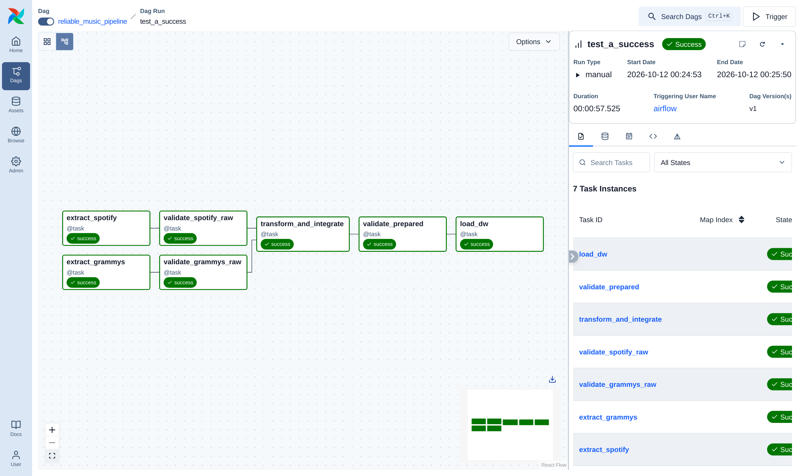
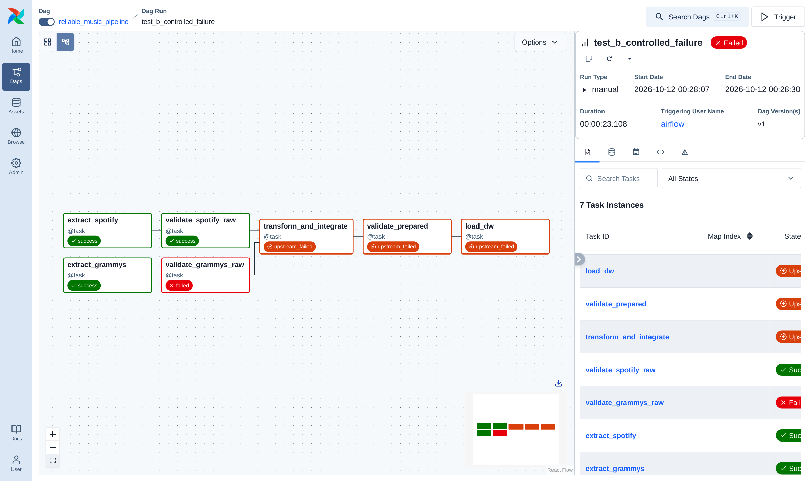
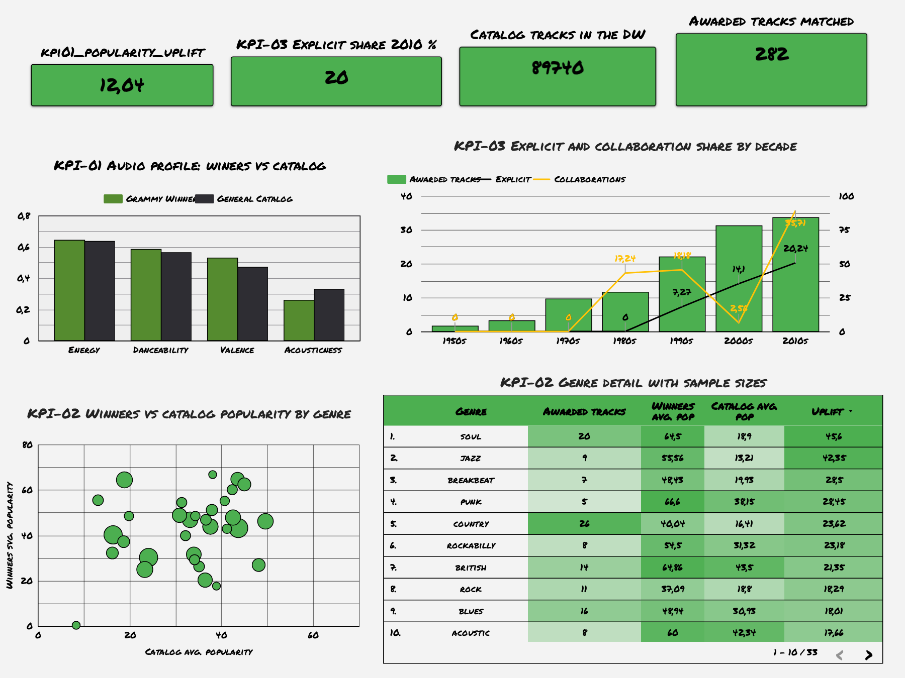

# Workshop-2 · Building a Reliable Batch Data Pipeline

**Course:** ETL (G01) · Data Engineering and Artificial Intelligence · Faculty of Engineering and Basic Sciences · 2026-2

A reliable batch pipeline that integrates the **Spotify catalog (CSV)** with the **Grammy Awards (PostgreSQL source database)**. It validates data with **Great Expectations** at raw and prepared gates, is orchestrated by **Apache Airflow 3.1.8** (TaskFlow API), loads a **star-schema Data Warehouse** in PostgreSQL and feeds a **BI dashboard** with three KPIs.

> *Reliable does not mean that nothing fails. Reliable means that failures are anticipated, controlled, and observable.*

| | |
| :--- | :--- |
| Orchestration | Airflow 3.1.8, `from airflow.sdk import dag, task` → [`dags/reliable_music_pipeline.py`](dags/reliable_music_pipeline.py) |
| Validation | GX 1.x: 3 suites, 3 Validation Definitions, 3 Checkpoints, 18 rules / 32 expectations → [`src/validation.py`](src/validation.py), [`gx/`](gx/) |
| Databases | PostgreSQL 16: `source_music_db` (Grammy source), `dw_music_analytics` (DW) |
| BI | **Looker Studio** dashboard on the DW views ([live report](https://lookerstudio.google.com/reporting/c356ff56-e259-40bf-86e3-083f3924a837), [`docs/dashboard_spec.md`](docs/dashboard_spec.md)); local alternative: Metabase |
| Evidence | [`docs/evidence/evidence_register.md`](docs/evidence/evidence_register.md) |

---

## 1. Problem and analytical objective

Music success is measured in two disconnected worlds: **listener consumption** (Spotify popularity and audio features) and **institutional recognition** (Grammy wins since 1958). Neither source can answer, on its own, whether awarded music sounds different, whether it is more popular and in which genres, or how awarded music has changed over the decades. The objective is a trusted analytical data product that integrates both sources, with every decision traceable from requirement to KPI.

## 2. Analytical requirements

| ID | Question / decision | Sources | KPI | Level of detail |
| :--- | :--- | :--- | :--- | :--- |
| **RQ-01** | Do Grammy-winning tracks differ in audio profile and popularity from the catalog? | Spotify features, popularity · Grammy winner | KPI-01 audio profile + popularity uplift | Distinct track × award status |
| **RQ-02** | In which genres is a Grammy associated with the largest popularity uplift? | Spotify genre, popularity · Grammy winner | KPI-02 uplift per genre (n ≥ 5) | Track × genre |
| **RQ-03** | How have explicit content and collaborations evolved among awarded tracks? | Spotify explicit, artists · Grammy year | KPI-03 % explicit / % collaborations per decade | Awarded track × decade |

Scope, the attribute → source mapping and the reason both sources are needed: [`docs/analytical_requirements.md`](docs/analytical_requirements.md). End-to-end chain: [`docs/traceability_matrix.md`](docs/traceability_matrix.md).

## 3. Data sources

| Source | Provided as | Extracted from | Volume |
| :--- | :--- | :--- | :--- |
| Spotify | `data/spotify_dataset.csv` | the CSV file (`extract_spotify`) | 114,000 rows × 21 columns |
| Grammy Awards | `data/the_grammy_awards.csv` | **PostgreSQL** `source_music_db.grammy_awards` (`extract_grammys`, SQL query) | 4,810 rows (1958–2019) |

**Source preparation (not the ETL load).** The `source-seed` service runs [`scripts/seed_source_db.py`](scripts/seed_source_db.py): it applies [`sql/source_setup.sql`](sql/source_setup.sql), inserts the CSV as-is and writes a reconciliation report ([`seed_report.json`](docs/evidence/source_preparation/seed_report.json): 4,810 CSV rows = 4,810 table rows; winners, year range and null nominees match). The original files are preserved untouched in `data/`.

## 4. Pipeline architecture

```
data/spotify_dataset.csv ─► extract_spotify ─► validate_spotify_raw ─┐
                                                                     ├─► transform_and_integrate ─► validate_prepared ─► load_dw ─► dw_music_analytics ─► Metabase
source_music_db.grammy_awards ─► extract_grammys ─► validate_grammys_raw ─┘
```

Logic lives in [`src/`](src/) (`extract.py`, `validation.py`, `transform.py`, `load.py`); the DAG only wires the tasks. Tasks exchange file paths and small metadata dicts, never DataFrames. Every run writes staging files to `data/staging/<run_id>/` and evidence to `docs/evidence/runs/<run_id>/`, so runs never overwrite each other. Details: [`docs/architecture.md`](docs/architecture.md).

## 5. Data profiling findings

Reproducible notebook with saved outputs and figures: [`notebooks/data_profiling.ipynb`](notebooks/data_profiling.ipynb).

- **Spotify:** 114,000 rows, 89,741 distinct `track_id`. The grain is track × genre (24,259 rows repeat a track in another genre). **450 exact duplicates** on (`track_id`, `track_genre`) (0.39%). **1 corrupted row** (duration 0 ms, null title/artist/album). Audio features within [0, 1]; popularity within [0, 100] with a mass at 0.
- **Grammys:** 4,810 rows, years 1958–2019, natural key (year, category, nominee) unique. **All rows are winners** (no nominee tier). 6 null `nominee` (0.12%). **1,840 null `artist` (38%)**, mostly categories that are not songs.
- **Cross-source:** Spotify separates artists with `;`, Grammys with `feat.` / `&` / `with`. On the (title, artist) key, raw text matches 161 Grammy keys and the normalized key matches 181.

## 6. Quality risks and quality rules

18 rules (13 Critical, 3 Warning, 2 Informational), each tied to profiling evidence, a requirement, the source contract or a post-transformation invariant. Full matrix with dimension, threshold and justification: [`docs/quality_rules.md`](docs/quality_rules.md).

| Gate | Rules | Examples |
| :--- | :--- | :--- |
| Spotify raw | DQ-RAW-SPT-01..06 | schema contract; `track_id` not null; duration > 1,000 ms (≥ 99.9%); 4 features in [0, 1]; popularity in [0, 100]; (track, genre) duplicates < 1% (Warning) |
| Grammy raw | DQ-RAW-GRM-01..04 | schema contract; **year in [1958, 2026]**; nominee ≥ 99.5% non-null (Warning); row-count band (Informational) |
| Prepared | DQ-PREP-INT-01..08 | exact schema; keys not null; ranges after transform; **unique fact grain**; integration integrity (matched ⇒ valid year and award_count ≥ 1, unmatched ⇒ year 0); both tiers exist and matched rows ≥ 0.1% (Critical); match rate ≤ 5% (Warning) |

## 7. Great Expectations validation design

For every gate: **Data Source → Data Asset → Batch Definition** (the run's staging Parquet) + **Expectation Suite** (each Expectation tagged with `meta.rule_id` and `meta.severity`) → **Validation Definition** → **Checkpoint** → severity policy:

- **Critical** → `CriticalDataQualityError`, the task fails and downstream tasks are `upstream_failed`.
- **Warning** → logged and recorded, `CONTINUE_WITH_WARNING`.
- **Informational** → recorded only.

Exported configuration: [`gx/expectations/`](gx/expectations/), [`gx/validation_definitions/`](gx/validation_definitions/), [`gx/checkpoints/`](gx/checkpoints/). Per-run machine-readable results with per-rule `unexpected_count` / `partial_unexpected_list`: `docs/evidence/runs/<run_id>/*_validation.json`. The Expectation → Rule ID mapping is in [`docs/quality_rules.md §3.1`](docs/quality_rules.md).

## 8. Transformation and integration strategy

One transformation phase, with each rule justified independently of validation ([`docs/transformation_decisions.md`](docs/transformation_decisions.md), TR-01..TR-12): drop corrupted rows, drop impossible durations, dedup (track, genre), normalize text, extract the primary artist, aggregate Grammys per key, derive `artist_type` and `decade`, map unmatched rows to default members, cast and round.

**Integration contract** ([`docs/integration_contract.md`](docs/integration_contract.md)): LEFT JOIN of the catalog to Grammy keys aggregated on (normalized title, normalized primary artist). The join is **many-to-one** and enforced (`validate="many_to_one"`). Result for this batch: **475 matched rows / 282 distinct tracks / 181 matched keys**; **4,257 Grammy keys unmatched (95.9%)**, measured in `integration_report.json`. Reconciliation: 114,000 − 1 − 450 = 113,549 prepared rows = 113,549 fact rows.

## 9. Dimensional model

Star schema in [`sql/dw_schema.sql`](sql/dw_schema.sql) (idempotent; applied by `load_dw`), documented in [`docs/dimensional_model.md`](docs/dimensional_model.md).

- **Business process:** catalog performance of a track in a genre, enriched with its Grammy recognition.
- **Grain:** one row per track × genre × award year × award category (unmatched tracks use default members, SK 0).
- **Dimensions:** `dim_track`, `dim_artist`, `dim_genre`, `dim_time` (year smart key), `dim_grammy_category`. Surrogate keys with UNIQUE business keys.
- **Measures:** popularity, danceability, energy, valence, acousticness, loudness, tempo, `award_count`, winner flags. Ranges are enforced with `CHECK` constraints.
- **Analytical views:** `vw_track_profile`, `vw_kpi1_audio_profile`, `vw_kpi2_genre_uplift`, `vw_kpi3_decade_trends`.

## 10. Airflow DAG design

`reliable_music_pipeline`: `schedule=None`, `catchup=False`, `max_active_runs=1`. Seven tasks: two independent source branches (extract → raw gate), convergence in `transform_and_integrate` (runs only if **both** raw gates succeed), `validate_prepared` gating `load_dw`. Each task logs `BATCH CONTEXT | dag run_id task try` plus its material counts. The DW `batch_id` is the Airflow `run_id`.

## 11. Failure and retry policy

| Task class | Retries | Why |
| :--- | :--- | :--- |
| `extract_spotify`, `extract_grammys` | 2, 15 s, exponential backoff (max 2 min) | Transient I/O or connection failures can succeed on another attempt. Demonstrated in **Test D**. |
| `validate_*`, `transform_and_integrate` | 0 | Deterministic: the same batch fails the same way. Fail fast and surface the evidence (Tests B and E). |
| `load_dw` | 1, 30 s | Transient lock or connection issues; the load is one atomic transaction, so a retry is safe. |

`DEFAULT_ARGS.retries = 0`; there is no blanket retry policy. Full failure-condition table: [`docs/architecture.md §3`](docs/architecture.md).

## 12. Successful execution evidence (Test A)

`test_a_success`: all 7 tasks succeed (≈ 36 s). Gates 9/9, 4/4 and 19/19. Load: 113,549 inserted = prepared rows; 89,740 tracks, 17,645 artists, 114 genres. Report: [`docs/evidence/test_a_success/test_a_report.md`](docs/evidence/test_a_success/test_a_report.md).



## 13. Controlled failure evidence (Test B)

`test_b_controlled_failure`: a row with `year = 1800` is inserted in the **source database**. `validate_grammys_raw` fails on **DQ-RAW-GRM-01 [Critical]** (`unexpected_count=1`, `[1800]`, decision `STOP`); `transform_and_integrate`, `validate_prepared` and `load_dw` are `upstream_failed`; the DW is unchanged. Report with the log and the GX result: [`docs/evidence/test_b_controlled_failure/test_b_report.md`](docs/evidence/test_b_controlled_failure/test_b_report.md).



**Prepared gate (Test E, `test_e_prepared_gate`, §6.9):** a simulated upstream format change appends a suffix to every Grammy artist credit. Both raw gates pass, but matched rows drop from 475 to 71 (0.063%). `validate_prepared` fails on **DQ-PREP-INT-07 [Critical]** (matched rows ≥ 0.1%) and `load_dw` is `upstream_failed`; the DW keeps the previous snapshot. The first execution of this test exposed that the gate only required one match, so the floor was added and all tests were rerun → [`test_e_report.md`](docs/evidence/test_e_prepared_gate/test_e_report.md).

**Selective retry (Test D, `test_d_transient_retry`):** the source DB refuses connections, `extract_grammys` try 1 fails and try 2 succeeds → [`test_d_report.md`](docs/evidence/test_d_selective_retry/test_d_report.md).

## 14. Repeatability strategy (Test C)

**Snapshot load in one transaction:** dimension upserts on business keys; fact `INSERT … ON CONFLICT (uq_fact_grain) DO UPDATE`; then `DELETE` rows whose `batch_id` ≠ current run (stale rows); a reconciliation guard rolls back on mismatch. `test_c_safe_rerun` with the same batch: **0 inserted, 113,549 updated, 0 purged**; rows, `SUM(popularity)` = 3,783,956, `AVG(danceability)` = 0.567031 and `SUM(award_count)` = 538 are identical before and after; 0 grain duplicates. A failure before or during the load leaves the previous snapshot intact. Report: [`docs/evidence/test_c_safe_rerun/test_c_report.md`](docs/evidence/test_c_safe_rerun/test_c_report.md).

## 15. Dashboard and analytical outputs

**Looker Studio** (a BI tool named in the brief) reads the Data Warehouse through its KPI views. Because Looker Studio connects from Google's servers, `scripts/publish_dw.py` publishes the star schema and its views to a cloud PostgreSQL (Neon) after each load, in one transaction and with a local-vs-cloud reconciliation ([`publish_report.json`](docs/evidence/bi_publication/publish_report.json)). Looker Studio uses a **read-only role that can only select the views**. Setup: [`docs/bi_looker_studio_guide.md`](docs/bi_looker_studio_guide.md).

**Live report:** https://lookerstudio.google.com/reporting/c356ff56-e259-40bf-86e3-083f3924a837



| Requirement | DW element | KPI / visualization | Result |
| :--- | :--- | :--- | :--- |
| RQ-01 | `vw_kpi_scorecards`, `vw_kpi1_audio_profile_long` | Scorecards + grouped columns | Winners **+12.04** popularity pts (45.21 vs 33.17); higher valence (0.53 vs 0.47), lower acousticness (0.26 vs 0.33) |
| RQ-02 | `vw_kpi2_genre_uplift_comparable` | Bubble scatter (winners vs catalog per genre, size = n) + heat-map table with n | Largest uplift: soul +45.6 (n=20), jazz +42.4 (n=9), country +23.6 (n=26); negative in pop (−21.3), electro (−16.2) |
| RQ-03 | `vw_kpi3_decade_trends`, `vw_kpi_scorecards` | Combo chart (tracks per decade + % lines) + scorecard | Explicit share 0% (≤1980s) → 7.3% → 14.1% → **20.2% (2010s)**; collaborations **35.7%** in the 2010s |

A local Metabase dashboard on the same views is also included (`scripts/setup_metabase.py`, [`metabase_dashboard.png`](docs/evidence/kpi/metabase_dashboard.png)) for offline demos, and [`docs/bi_tableau_guide.md`](docs/bi_tableau_guide.md) shows the same views in Tableau. Static copies with the numbers in CSV: [`docs/evidence/kpi/`](docs/evidence/kpi/).

## 16. Setup and execution

**Prerequisites:** Docker Desktop (Compose v2). Nothing else is required on the host.

```bash
cp .env.example .env            # set POSTGRES_PASSWORD and MB_ADMIN_PASSWORD; change ports if busy
docker compose up -d --build    # postgres, airflow-init, source-seed (Grammy source + reconciliation), airflow, metabase
```

| What | Where |
| :--- | :--- |
| Airflow UI | `http://localhost:8080` (or `AIRFLOW_PORT`), DAG `reliable_music_pipeline`. Local only: every visitor is admin, bound to 127.0.0.1. |
| Looker Studio | public report link in section 15 (data from the published DW copy) |
| Metabase (local) | `http://localhost:3000` (or `METABASE_PORT`) |
| PostgreSQL | `localhost:5432`, databases `source_music_db`, `dw_music_analytics` |

```bash
# Run the pipeline once
docker compose exec airflow airflow dags trigger reliable_music_pipeline

# Reproduce Tests A, C, B, D and E with evidence (about 8 minutes); pass letters to run a subset
bash scripts/run_reliability_tests.sh

# Publish the DW to the cloud PostgreSQL read by Looker Studio (needs BI_DW_URL in .env)
docker compose exec airflow python /opt/airflow/scripts/publish_dw.py

# Build the local Metabase dashboard and the static KPI charts
docker compose exec airflow python /opt/airflow/scripts/setup_metabase.py
docker compose exec airflow python /opt/airflow/scripts/generate_kpi_charts.py

# Re-execute the profiling notebook
docker compose exec -w /opt/airflow/notebooks airflow jupyter nbconvert --to notebook --execute --inplace data_profiling.ipynb

# Capture Airflow / Metabase / Looker Studio screenshots (official Playwright image)
docker run --rm --network workshop2etl_workshop2_net -v "$PWD":/work -w /work \
  mcr.microsoft.com/playwright/python:v1.47.0-jammy \
  bash -c "pip install -q playwright==1.47.0 && python scripts/capture_airflow_evidence.py"
```

Rebuild the DW from scratch: `docker compose exec postgres psql -U postgres -d dw_music_analytics -f /sql/dw_reset.sql`; the next `load_dw` recreates it. Secrets live only in `.env` (git-ignored); `.env.example` documents the variables with placeholders.

### Repository structure

```
dags/reliable_music_pipeline.py   DAG (TaskFlow, airflow.sdk)
src/                              extract · validation (GX) · transform · load
sql/                              source_setup.sql · dw_schema.sql (+ KPI views) · dw_reset.sql · init script
gx/                               exported Expectation Suites, Validation Definitions, Checkpoints
notebooks/data_profiling.ipynb    executed profiling notebook
scripts/                          seed · reliability tests · DW publication · Metabase · KPI charts · log export · screenshots
docs/                             requirements · architecture · quality rules · transformations · integration · model · dashboard · traceability
docs/evidence/                    register · per-run JSON (runs/) · Test A–E reports, logs, screenshots · KPI outputs
data/                             original input files (unchanged)
```

## 17. Assumptions and limitations

- **Only winners** exist in the Grammy file, so the analysis is winners vs catalog (`is_grammy_nominee` = `is_grammy_winner`).
- **Exact match on normalized (title, primary artist).** Remasters, live versions, translated titles and different credits do not match. 38% of awards have no artist, and many categories are not songs. Coverage (0.42% of catalog rows, 4.1% of Grammy keys) is measured on every run, not hidden.
- **Multi-award keys** keep the latest year and the first category; RQ-03 uses the track's latest award.
- **Popularity is a single Spotify snapshot**: the results show association, not a causal post-award effect. Genres with few awarded tracks (n shown) are unstable.
- **Award years end in 2019**; the year rule allows up to 2026 for future batches.
- **The Looker Studio dashboard reads a published copy of the DW**, refreshed by `publish_dw.py` after each load (Looker caches data for up to 12 h). The local DW remains the system of record.
- The local setup (all-admin Airflow UI, Metabase public link) is meant for a single developer machine and binds every port to 127.0.0.1; it is not a production configuration.

### Defense deck

[`docs/presentation.html`](docs/presentation.html) is a single-file deck with 20 slides, organized by rubric criterion, with embedded evidence screenshots. Keys: ← → to navigate, **N** for speaker notes, **G** for overview, **F** for fullscreen; click a screenshot to zoom. A PDF export is in [`docs/presentation.pdf`](docs/presentation.pdf). To rebuild it after new evidence: `python3 scripts/build_presentation.py` (content in `scripts/presentation_template.html`).
