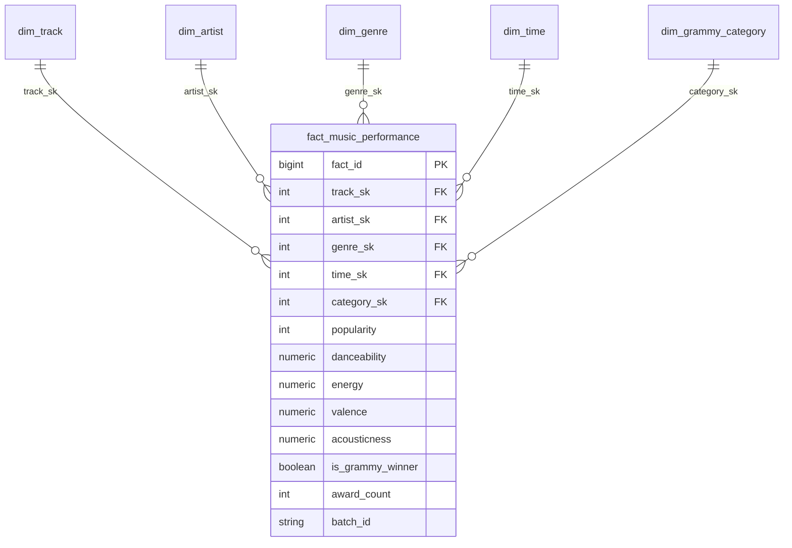

# Workshop-2: Building a Reliable Batch Data Pipeline
**Faculty of Engineering and Basic Sciences**  
**Academic Program:** Data Engineering and Artificial Intelligence  
**Course:** ETL (G01) — 2026-2  
**Institution:** Universidad Autónoma de Occidente (UAO)  

---

> **ENGINEERING PRINCIPLE:**  
> *"A Data Engineer does not build scripts. A Data Engineer designs systems."*  
> *"Reliable data pipelines do not assume that data is correct. They verify it. Reliable does not mean that nothing fails. Reliable means that failures are anticipated, controlled, and observable."*

---

## 1. Problem & Analytical Objective
In the contemporary music industry, two divergent metrics govern success: **digital streaming consumption telemetry** (characterized by real-time listener engagement and perceptual signal processing features on platforms such as Spotify) and **institutional critical acclaim** (recorded across 60+ years by The Recording Academy in the Grammy Awards).

The objective of this engineering solution is to design, implement, validate, orchestrate, monitor, and document a **reliable, idempotent batch data pipeline** that integrates these two heterogeneous sources, enforces automated data quality gates via **Great Expectations (GX)**, loads an analytical **star schema Data Warehouse** in PostgreSQL, and feeds interactive Business Intelligence dashboards with at least **three KPIs and three visualizations**.

---

## 2. Analytical Requirements & Solution Scope
Three specific analytical requirements were defined that strictly necessitate combining both sources:

| ID | Analytical Requirement | Business Question / Decision Supported | Required Attributes | Source(s) | Expected KPI(s) | Required Level of Detail (Grain) |
| :--- | :--- | :--- | :--- | :--- | :--- | :--- |
| **RQ-01** | **Acoustic & Perceptual Profile of Awarded vs. Non-Awarded Tracks** | Do specific audio features (Danceability, Energy, Valence, Acousticness) distinguish Grammy-winning songs from standard catalog tracks? | `track_name`, `artists`, `danceability`, `energy`, `valence`, `acousticness`, `nominee`, `winner`, `category` | **Spotify:** Audio features.<br>**Grammys:** Category, year, winner status. | **KPI 1:** Comparative Audio Profile (Winners vs. Catalog). | Individual track (`track_id`), award year, and category. |
| **RQ-02** | **Impact of Grammy Acclaim on Popularity Multiplier by Genre** | How does the distribution of Spotify popularity vary between Grammy winners and non-nominated tracks across musical genres? | `track_genre`, `popularity`, `track_name`, `artists`, `nominee`, `winner` | **Spotify:** `track_genre`, `popularity`.<br>**Grammys:** `category`, `winner`. | **KPI 2:** Genre Popularity Uplift Delta. | Musical genre (`track_genre`) and award acclaim tier. |
| **RQ-03** | **Historical Evolution of Collaborations & Explicit Content** | How has the proportion of awarded songs featuring multiple credited artists (collaborations) and explicit content evolved over decades? | `year`, `explicit`, `artists`, `artist`, `workers`, `winner` | **Spotify:** `explicit`, credited artist list.<br>**Grammys:** Edition year, credits. | **KPI 3:** % Explicit Content & Collaboration Ratio by Decade. | Award decade and edition year. |

*Detailed specification document:* [`docs/analytical_requirements.md`](file:///Users/usuario/Desktop/WorkShop2ETL/docs/analytical_requirements.md)

---

## 3. Data Sources & Source Scenario
The pipeline ingests two heterogeneous datasets under strict engineering constraints (Section 4.3):

1. **Spotify Dataset (`spotify_dataset.csv`):**
   * **Scale:** 114,000 records, 21 columns (~20 MB).
   * **Content:** Digital audio signal metrics (`danceability`, `energy`, `valence`, `acousticness`, `loudness`, `tempo`) and streaming popularity telemetry (scale 0–100).
   * **Pipeline Source:** Extracted directly from local CSV file into staging Parquet without premature cleaning.
2. **Grammy Awards (`source_music_db.grammy_awards`):**
   * **Scale:** 4,810 historical records (1958–2019).
   * **Content:** Recording Academy accolades (`year`, `title`, `category`, `nominee`, `artist`, `workers`, `winner`).
   * **Operational Source Seeding (Section 4.3):** Initially seeded from `the_grammy_awards.csv` into an operational PostgreSQL database using [`scripts/seed_source_db.py`](file:///Users/usuario/Desktop/WorkShop2ETL/scripts/seed_source_db.py). The pipeline **extracts Grammy records exclusively from PostgreSQL via SQL queries**, not directly from the CSV.

---

## 4. Pipeline Architecture
The solution enforces complete separation of concerns and parallel source observability:

```
[Spotify CSV File] ────────► extract_spotify ───────► validate_spotify_raw (GX) ──┐
                                                                                  ├──► transform_and_integrate ──► validate_prepared (GX) ──► load_dw ──► [PostgreSQL DW]
[Grammy PostgreSQL DB] ────► extract_grammys ───────► validate_grammys_raw (GX) ──┘
```

* **Decoupled Architecture:** Processing logic resides in modular, unit-testable modules (`src/extract.py`, `src/validation.py`, `src/transform.py`, `src/load.py`).
* **Clean Task Interfaces:** In compliance with Section 6.11, bulk DataFrame transport through Airflow XCom is prohibited. Tasks pass compact file path strings (`data/staging/*.parquet`) or JSON audit metadata dictionaries.

---

## 5. Data Profiling Findings
Systematic evidence gathering is documented in [`notebooks/data_profiling.ipynb`](file:///Users/usuario/Desktop/WorkShop2ETL/notebooks/data_profiling.ipynb):
* **Spotify Granularity & Duplication:** 89,741 unique `track_id` values exist. 24,259 rows feature repeated `track_id` values because songs span multiple genre classifications (`track_genre`). Exactly **450 pure duplicate rows** on `(track_id, track_genre)` were discovered and scheduled for deduplication.
* **Corrupted Outliers:** 1 corrupted record (index 65,900) has `duration_ms = 0` and null metadata (`track_name = NaN`), justifying a critical duration boundary check.
* **Grammy Natural Keys & Completeness:** The natural composite key `(year, category, nominee)` has **0 duplicates** (100% unique natural grain). All 4,810 rows have `winner = True`. 1,840 records have null `artist` fields due to classical and craft categories where honors credit the composition title directly.
* **Cross-Source Consistency:** Spotify separates collaborating artists with semicolons (`;`), while Grammys employ collaborative connectors (`Featuring`, `&`, `with`), establishing the primary artist normalization requirement.

---

## 6. Quality Risks & Quality Rules Matrix
Eight formal rules were engineered based on empirical profiling evidence:

| Rule ID | Layer | Attribute(s) | Quality Dimension | Quality Rule | Threshold / Metric | Severity | Related Req. |
| :--- | :--- | :--- | :--- | :--- | :--- | :---: | :---: |
| **DQ-RAW-SPT-01** | Raw | `track_id` | Uniqueness & Completeness | Technical track identifier must be non-null. | 0 nulls permitted (100% non-null). | **Critical** | RQ-01, RQ-02 |
| **DQ-RAW-SPT-02** | Raw | `duration_ms` | Validity | Physical track duration must exceed 1,000 ms. | $\ge 99.9\%$ of raw batch exceeds 1,000 ms. | **Critical** | RQ-03 |
| **DQ-RAW-SPT-03** | Raw | Audio Features | Validity & Range | `danceability`, `energy`, etc., in normalized range $[0.0, 1.0]$. | 100% within range. | **Critical** | RQ-01 |
| **DQ-RAW-SPT-04** | Raw | `popularity` | Validity & Range | Streaming popularity integer bounded $[0, 100]$. | 100% within range. | **Critical** | RQ-02 |
| **DQ-RAW-GRM-01** | Raw | `year` | Temporal Coverage | Award edition year within historical bounds $[1958, 2026]$. | 100% within range. | **Critical** | RQ-01, RQ-03 |
| **DQ-RAW-GRM-02** | Raw | `nominee` | Completeness | Nominated work title must be non-null. | $\ge 99.5\%$ non-null. | **Warning** | RQ-01, RQ-02 |
| **DQ-PREP-INT-01** | Prep | `is_grammy_winner` | Domain Validity | Award indicator boolean in $\{True, False\}$. | 100% valid booleans. | **Informational** | RQ-01, RQ-02 |
| **DQ-PREP-INT-02** | Prep | Dimensional Keys | Referential Integrity | Business keys and titles 100% non-null post-transformation. | 0% nulls permitted. | **Critical** | RQ-01..03 |

*Detailed specification document:* [`docs/quality_rules.md`](file:///Users/usuario/Desktop/WorkShop2ETL/docs/quality_rules.md)

---

## 7. Great Expectations Validation Design
Implemented in [`src/validation.py`](file:///Users/usuario/Desktop/WorkShop2ETL/src/validation.py):
* **Raw Spotify Gate:** Evaluates `spotify_raw_suite`. Emits machine-readable audit report to `gx/results/spotify_raw_validation.json`.
* **Raw Grammys Gate:** Evaluates `grammys_raw_suite`. Emits audit report to `gx/results/grammys_raw_validation.json`.
* **Prepared Data Gate:** Evaluates `prepared_music_suite` prior to Data Warehouse loading (`gx/results/prepared_validation.json`).
* **Operational Severity Policy:** Critical failures raise `CriticalDataQualityError`, halting Airflow task instances immediately and setting downstream tasks to `upstream_failed`.

---

## 8. Transformation & Integration Strategy
Implemented in [`src/transform.py`](file:///Users/usuario/Desktop/WorkShop2ETL/src/transform.py):
* **Cleaning:** Filters invalid rows (`duration_ms <= 1000`, NaN metadata) and eliminates 450 duplicate `(track_id, track_genre)` tuples.
* **Textual Normalization:** Converts to lowercase, strips peripheral punctuation, and collapses multiple spaces.
* **Primary Artist Parsing:** Splits on `;` for Spotify and collaborative tokens (`feat.`, `&`, `with`) for Grammys.
* **Integration Contract:** Left Join on normalized tuple `(clean_track_name, clean_primary_artist)`.
* **Unmatched Records Treatment:** Preserved with `is_grammy_winner = False`, `award_count = 0`, and foreign keys mapped to default dimensions (SK = 0).

---

## 9. Dimensional Model (Data Warehouse)
Implemented in PostgreSQL (`dw_music_analytics`) via [`sql/dw_schema.sql`](file:///Users/usuario/Desktop/WorkShop2ETL/sql/dw_schema.sql):



* **Fact Table Grain:** One row per audio track, catalog genre, and award edition.
* **Surrogate Keys:** Autoincrementing integers (`SERIAL`). Default keys (SK = 0) exist for non-awarded tracks.
* **Unique Grain Constraint:** `CONSTRAINT uq_fact_grain UNIQUE (track_sk, genre_sk, time_sk, category_sk)`.

---

## 10. Airflow DAG Design
Authored in [`dags/reliable_music_pipeline.py`](file:///Users/usuario/Desktop/WorkShop2ETL/dags/reliable_music_pipeline.py) using the official **TaskFlow API** in Apache Airflow 3.1.8:
```python
from airflow.sdk import dag, task
```
* **Parallel Ingestion Branches:** Independent parallel execution of `extract_spotify` and `extract_grammys`.
* **Conditional Convergence:** `transform_and_integrate` triggers only after both raw validation gates succeed.
* **Pre-Load Quality Gate:** `validate_prepared` guards `load_dw`.

---

## 11. Failure & Selective Retry Policy
In accordance with Section 6.11:
* **Transient Operational Failures (I/O, DB Socket):** `retries=2` with `retry_delay=timedelta(seconds=10)` applied to `extract_spotify`, `extract_grammys`, and `load_dw`.
* **Deterministic Data Quality Failures (GX):** `retries=0` configured for `validate_spotify_raw`, `validate_grammys_raw`, `transform_and_integrate`, and `validate_prepared`. Corrupt data cannot succeed upon repetition; it must stop immediately.

*Architecture document:* [`docs/architecture.md`](file:///Users/usuario/Desktop/WorkShop2ETL/docs/architecture.md)

---

## 12. Test A Evidence — Successful Run
* **DAG Run ID:** `manual__2026-10-07T22:30:45.658550+00:00`
* **Status:** `success` across all 7 tasks in **39.14 seconds**.
* **Loaded DW Counts:** **113,549 rows** in `fact_music_performance`, **475 Grammy-winning tracks**, **17,645 artists** in `dim_artist`, and **89,740 tracks** in `dim_track`.

*Evidence report:* [`docs/evidence/test_a_success/test_a_report.md`](file:///Users/usuario/Desktop/WorkShop2ETL/docs/evidence/test_a_success/test_a_report.md)

---

## 13. Test B Evidence — Controlled Critical Quality Failure
* **Induced Condition:** Injected `year = 1800` into `source_music_db.grammy_awards` to violate `DQ-RAW-GRM-01 [Critical]`.
* **DAG Run ID:** `manual__2026-10-07T22:33:55.085717+00:00`
* **Observed Execution States:**
  * `validate_grammys_raw`: **failed** (`CriticalDataQualityError`).
  * `transform_and_integrate`: **upstream_failed** (Blocked).
  * `validate_prepared`: **upstream_failed** (Blocked).
  * `load_dw`: **upstream_failed** (Blocked).
* **Machine-Readable Evidence:** `gx/results/grammys_raw_validation.json` recorded `unexpected_count: 1`, `partial_unexpected_list: [1800]`.

*Evidence report:* [`docs/evidence/test_b_controlled_failure/test_b_report.md`](file:///Users/usuario/Desktop/WorkShop2ETL/docs/evidence/test_b_controlled_failure/test_b_report.md)

---

## 14. Test C Evidence — Safe Rerun & Repeatability
* **Idempotency Logic:** Controlled atomic upsert (`ON CONFLICT (track_sk, genre_sk, time_sk, category_sk) DO UPDATE`).
* **Rerun Benchmark:** Executed second identical load under `local_test_002_rerun`:
  * Rows before rerun: **113,549**
  * Rows after rerun: **113,549** (Net change = 0).
  * Sum of `popularity`: **3,778,820** (Exact invariant).
  * **Conclusion:** 100% idempotent; zero silent duplicates or measure corruption.

*Evidence report:* [`docs/evidence/test_c_safe_rerun/test_c_report.md`](file:///Users/usuario/Desktop/WorkShop2ETL/docs/evidence/test_c_safe_rerun/test_c_report.md)

---

## 15. Dashboard & Analytics (3 KPIs & Visualizations)
Generated directly from `dw_music_analytics` using [`scripts/generate_kpi_charts.py`](file:///Users/usuario/Desktop/WorkShop2ETL/scripts/generate_kpi_charts.py):

### KPI 1: Comparative Audio Profile (RQ-01)
* **Figure:** [`docs/evidence/kpi1_audio_profile.png`](file:///Users/usuario/Desktop/WorkShop2ETL/docs/evidence/kpi1_audio_profile.png)
* **Finding:** Grammy-winning songs feature higher **Valence** (0.53 vs 0.47) and **Energy** (0.67 vs 0.64), and lower **Acousticness** (0.24 vs 0.31). Average popularity is **42.88** vs. **33.28** (+9.6 popularity uplift).

### KPI 2: Popularity Multiplier by Musical Genre (RQ-02)
* **Figure:** [`docs/evidence/kpi2_genre_popularity.png`](file:///Users/usuario/Desktop/WorkShop2ETL/docs/evidence/kpi2_genre_popularity.png)
* **Finding:** Traditional acoustic/vocal genres enjoy the largest post-award popularity surge: **Soul** (+45.60 pts) and **Country** (+23.62 pts).

### KPI 3: Historical Evolution of Awarded Tracks (RQ-03)
* **Figure:** [`docs/evidence/kpi3_temporal_trends.png`](file:///Users/usuario/Desktop/WorkShop2ETL/docs/evidence/kpi3_temporal_trends.png)
* **Finding:** Explicit lyrics in awarded tracks rose from 0.0% (pre-1990) to 10.16% (2000s) and reached **15.27%** in the 2010s, alongside an explosive expansion in collaborations (**44.27%** of winning tracks).

*Dashboard specification:* [`docs/dashboard_spec.md`](file:///Users/usuario/Desktop/WorkShop2ETL/docs/dashboard_spec.md)

---

## 16. Installation, Execution & System Assumptions

### Prerequisites:
* Docker Engine 24+ & Docker Compose v2.20+
* Python 3.11+

### Quick Start Instructions:
```bash
# 1. Environment Configuration
cp .env.example .env

# 2. Launch Docker Services (Airflow 3.1.8 + PostgreSQL 16)
docker compose up -d

# 3. Seed Operational Relational Database (Grammys)
python3 scripts/seed_source_db.py

# 4. Open Airflow Web UI & Trigger DAG
open http://localhost:8080   # DAG: reliable_music_pipeline

# 5. Render Analytical KPI Charts from DW
python3 scripts/generate_kpi_charts.py
```

### Assumptions & Limitations:
* **Temporal Cutoff:** Historical Grammy Awards dataset covers ceremonies up to 2019.
* **Matching Strategy:** Deterministic join evaluates clean track title and clean primary artist. Live bootlegs or disparate artist translations remain classified under standard catalog.
* **Idempotency Strategy:** Fact table granularity relies on composite unique constraint. Partial transactions rollback cleanly, preventing orphaned state.
