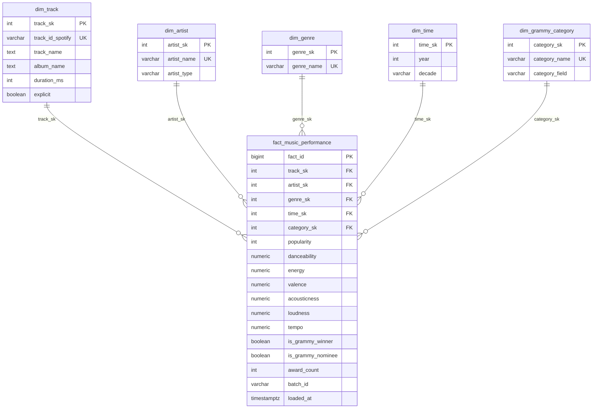

# Dimensional Model — `dw_music_analytics`

Sections 6.4 and 6.10 of the brief. Executable definition: [`sql/dw_schema.sql`](../sql/dw_schema.sql) (idempotent, applied by `load_dw`). Destructive rebuild: [`sql/dw_reset.sql`](../sql/dw_reset.sql) (manual only).

## Design decisions

| Design decision | Content |
| :--- | :--- |
| **Business process** | Catalog performance of a music track: its Spotify popularity and audio profile in a catalog genre, enriched with the Grammy recognition the track received. |
| **Grain of the fact table** | One row per **Spotify track × catalog genre × award edition (year) × award category**. Tracks without an award use the default members `time_sk = 0` and `category_sk = 0`, so in this batch every track/genre has exactly one row (113,549 rows = clean catalog rows). |
| **Dimensions** | `dim_track` (track, album, duration, explicit) · `dim_artist` (primary artist, Solo/Collaboration) · `dim_genre` (Spotify genre) · `dim_time` (award year, decade) · `dim_grammy_category` (award category). |
| **Measures** | `popularity` (0–100), `danceability`, `energy`, `valence`, `acousticness` (0–1), `loudness`, `tempo` (non-additive: averaged); `is_grammy_winner`, `is_grammy_nominee` (flags, counted); `award_count` (additive). |
| **Keys** | Surrogate keys `SERIAL` for track, artist, genre and category; `dim_time` uses the year as a smart key (0 = Unknown). Business keys with `UNIQUE` constraints: `track_id_spotify`, `artist_name`, `genre_name`, `category_name`. The fact table has `fact_id BIGSERIAL` plus the grain constraint `uq_fact_grain`. |
| **Relationships** | Every fact foreign key `REFERENCES` its dimension (`NOT NULL`). Default members (SK 0) avoid NULL foreign keys for unmatched tracks. `CHECK` constraints enforce measure ranges at the database level. |
| **Audit** | `batch_id` (= Airflow `run_id`) and `loaded_at` on every fact row. |

## Requirement support

| Requirement | Facts / dimensions used | DW element (view) |
| :--- | :--- | :--- |
| RQ-01 Audio profile, winners vs catalog | audio measures, `popularity`, `is_grammy_winner`, `dim_track` | `vw_track_profile` → `vw_kpi1_audio_profile` |
| RQ-02 Popularity uplift by genre | `popularity`, `is_grammy_winner`, `dim_genre` | `vw_kpi2_genre_uplift` |
| RQ-03 Explicit and collaboration share by decade | `dim_track.explicit`, `dim_artist.artist_type`, `dim_time.decade`, `is_grammy_winner` | `vw_track_profile` → `vw_kpi3_decade_trends` |

Because a track can appear in several genres, the track-level KPIs (RQ-01, RQ-03) first collapse the facts to one row per track (`vw_track_profile`) so that a song is never counted more than once. RQ-02 is genre-level, so it uses the fact grain directly and reports the sample size (`n_winner_tracks`) per genre.

## Loaded volumes (test_a_success)

| Table | Rows |
| :--- | ---: |
| `fact_music_performance` | 113,549 (475 winner rows) |
| `dim_track` | 89,740 |
| `dim_artist` | 17,645 |
| `dim_genre` | 114 |
| `dim_time` | 53 (52 award years + Unknown) |
| `dim_grammy_category` | 68 (67 + default) |
